# two_stage_cmos_opamp
A two-stage Miller-compensated op-amp designed in Cadence Virtuoso using the gpdk180 with 180 nm and 1.8 V process. This op-amp was designed from measured process parameters and was verified across 45 PVT corners and 200 Monte Carlo samples.
 
## Results
| Parameter | Spec | Nominal | Worst PVT corner |
|---|---|---|---|
| DC gain | ≥ 60 dB | 80.6 dB | 74.1 dB |
| GBW | ≥ 10 MHz | 14.45 MHz | 10.89 MHz |
| Phase margin | ≥ 60° | 72.6° | 71.0° |
| Slew rate | ≥ 10 V/µs | 15.8 V/µs | 13.1 V/µs |
| Power | ≤ 1 mW | 0.29 mW | 0.32 mW |
| Input range | 0.9 – 1.5 V | 0.9 – 1.65 V | — |
| Output swing | 0.3 – 1.5 V | 0.12 – 1.62 V | — |
| Offset (Monte Carlo) | — | σ = 7.8 mV | — |
 
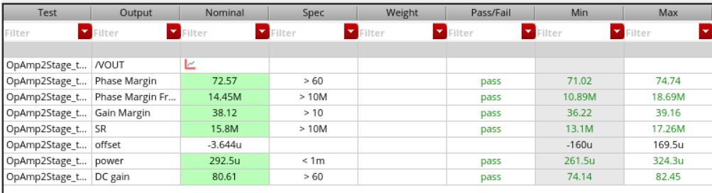
 
 
## 1. Circuit Schematic
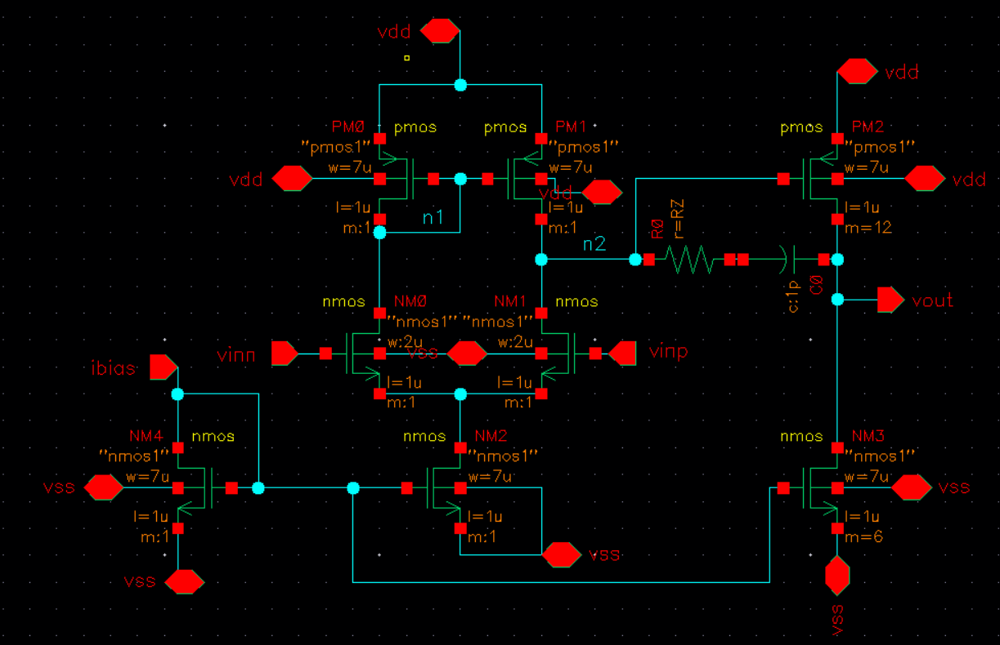
 
# Transistor Specifications
| Device | W / L | multiplicity |
|---|---|---|
| NM0, NM1 | Input pair | 2 / 1 µm | 1 |
| PM0, PM1 | Mirror load | 7 / 1 µm | 1 |
| NM2 | Tail current | 7 / 1 µm | 1 |
| PM2 | Second stage | 7 / 1 µm | 12 |
| NM3 | Output current sink | 7 / 1 µm | 6 |
| NM4 | Bias | 7 / 1 µm | 1 |
 
# Capacitor, Null Resistor, and Bias Current Values
C_L = 2 pF, C_c = 1 pF, R_z = 2.5 kΩ, I_bias = 20 µA.
 
## 2. Hand Design
Process parameters were extracted from single-transistor simulations:
 
$$k' = \frac{g_m^2}{2\,(W/L)\,I_D} \qquad \lambda = \frac{g_{ds}}{I_D}$$
 
| | NMOS | PMOS |
|---|---|---|
| V_T | 0.49 V | 0.46 V |
| k′ | 255 µA/V² | 48 µA/V² |
| λ | 0.037 V⁻¹ | 0.041 V⁻¹ |
 
Key design equations:
 
$$\text{GBW} = \frac{g_{m1}}{2\pi C_c} \qquad \text{SR} = \frac{I_5}{C_c} \qquad p_2 \approx \frac{g_{m6}}{2\pi C_L} \qquad z_{RHP} = \frac{g_{m6}}{2\pi C_c}$$
 
$$A_v = \frac{g_{m1}}{g_{ds2}+g_{ds4}} \cdot \frac{g_{m6}}{g_{ds6}+g_{ds7}} \qquad \frac{(W/L)_6}{(W/L)_4} = 2\,\frac{(W/L)_7}{(W/L)_5}$$
 
| | Hand calc | Simulated |
|---|---|---|
| DC gain | ~80 dB | 80.6 dB |
| GBW | ~16 MHz | 14.45 MHz |
| Slew rate | 20 V/µs | 15.8 V/µs |
| Power | 0.29 mW | 0.29 mW |
 
## 3. Stability
The Miller capacitor creates a right-half-plane zero that costs phase margin. Using a resistor (R_z) in series with the Miller capacitor moves the zero into the left half-plane:
 
$$z = \frac{1}{2\pi C_c\left(\frac{1}{g_{m6}} - R_z\right)}$$
 
R_z = 2.5 kΩ puts the zero at ~106 MHz, about 7× the unity-gain frequency. This was chosen by sweeping R_z from 0 to 6kΩ.
 
| | Phase margin | Gain margin |
|---|---|---|
| C_c w/o R_z | 61.2° | 17.2 dB |
| With R_z = 2.5 kΩ | 72.6° | 38.1 dB |
 
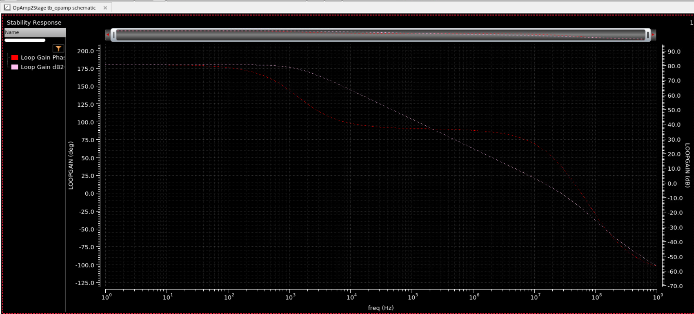
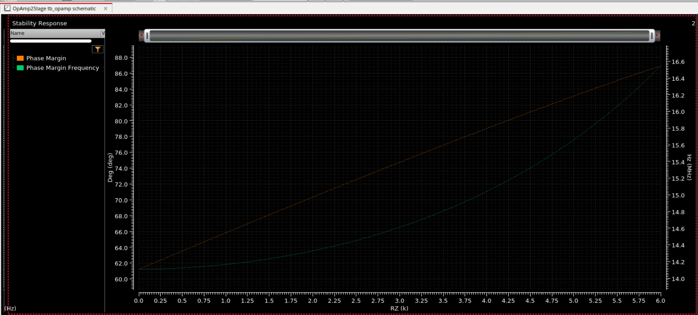
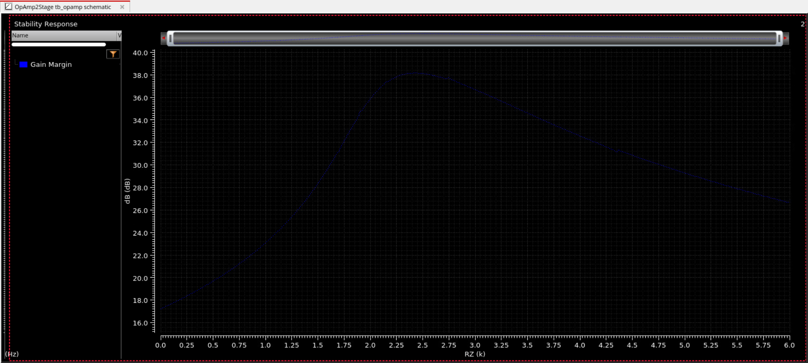
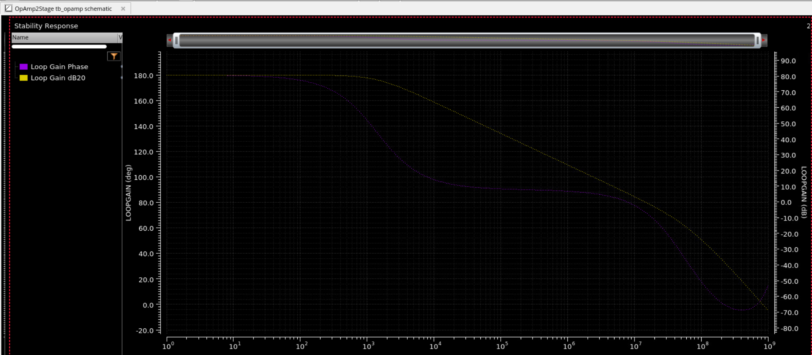
 
 
## 4. Transient
0.9 V ↔ 1.4 V step in unity-gain buffer.
 
| Slew rate (rising) | Slew rate (falling) | 1% settling time |
|---|---|---|
| 15.8 V/µs | 15.3 V/µs | 51.2 ns |
 
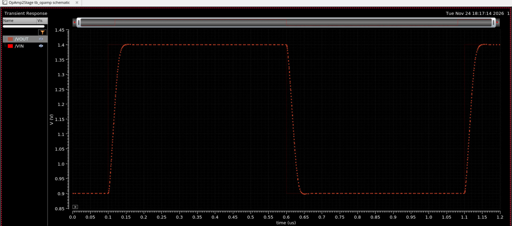
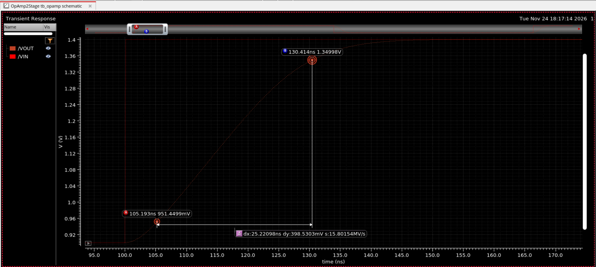
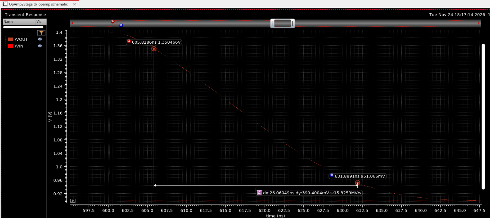
 
## 5. Input and Output Range
$$V_{CM,min} = V_{GS1} + V_{DS,sat5} \qquad V_{CM,max} = V_{DD} - |V_{GS3}| + V_{Tn}$$
 
$$V_{DS,sat7} \le V_{out} \le V_{DD} - |V_{DS,sat6}|$$
 
Input range: 0.9 – 1.65 V. Output swing: 0.12 – 1.62 V where there is a gain of −2 (within 1%)
 
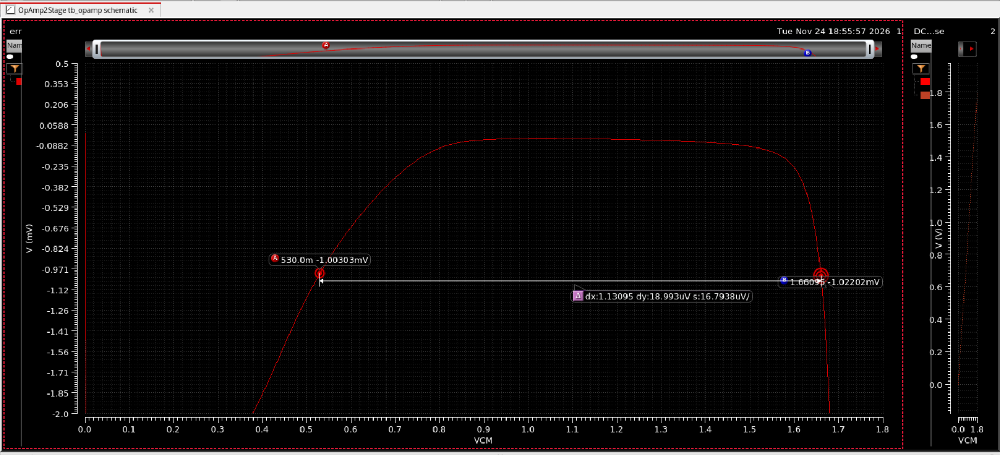
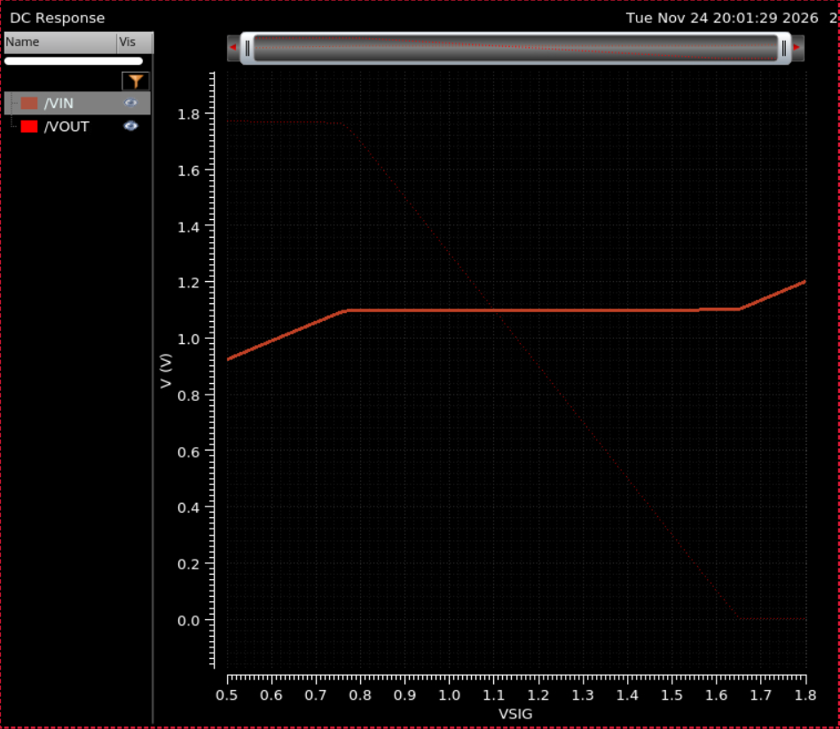
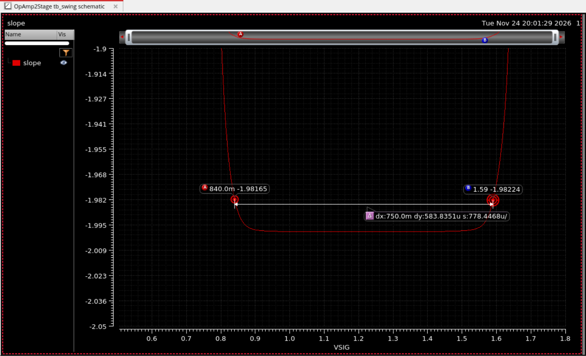
 
## 6. PSRR and CMRR
 
$$\text{PSRR} = \frac{A_{dm}}{A_{vdd}} \qquad \text{CMRR} = \frac{A_{dm}}{A_{cm}}$$
 
Both were measured in the unity-gain buffer by injecting a 1 V AC signal, on V_DD for PSRR and on both inputs together for CMRR.
 
$$\text{PSRR}_{dB} = -20\log_{10}\left|\frac{v_{out}}{v_{dd}}\right| \qquad \text{CMRR}_{dB} = -20\log_{10}\left|\frac{v_{out}}{v_{cm}}\right|$$
 
| | DC | 1 MHz |
|---|---|---|
| PSRR+ | 83.5 dB | 23.7 dB |
| CMRR | 83.9 dB | 80.2 dB |
 
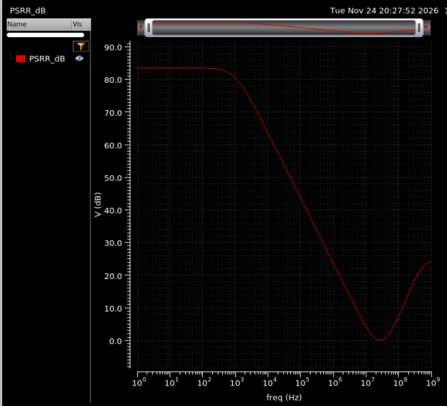
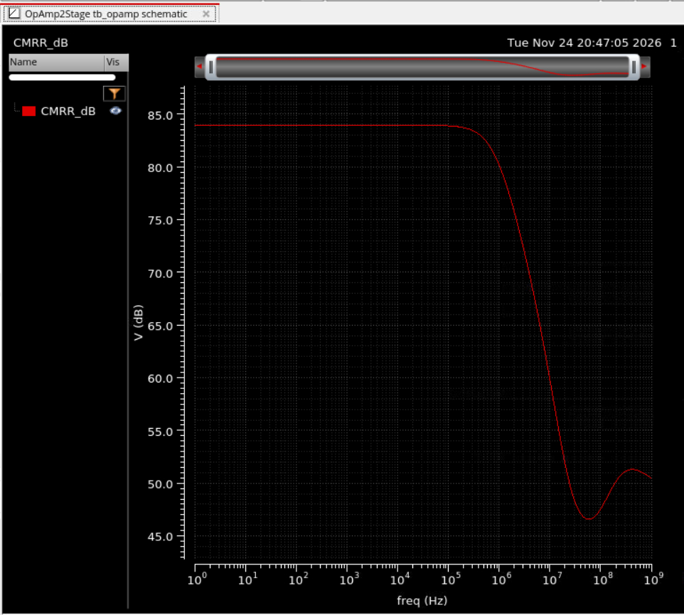
 
## 7. PVT Corners (45 Corners, All Passing)
 
5 process corners (TT, SS, FF, SF, FS) × 3 supplies (1.62 / 1.8 / 1.98 V) × 3 temperatures (−40 / 27 / 125 °C) = 45 corners
 
The tightest spec is GBW. This was worst at hot slow-NMOS. Considering the bias current to be fixed:
 
$$\text{GBW} \propto g_{m1} = \sqrt{2\mu_n C_{ox}\tfrac{W}{L}I_D} \;\Rightarrow\; \text{GBW} \propto \sqrt{\mu}, \qquad \mu \propto T^{-1.5}$$
 
This predicts GBW falls to 0.81× at 125 °C giving 11.7 MHz. The simulation gives 11.56 MHz.
 
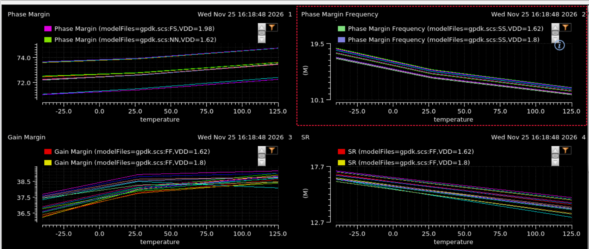
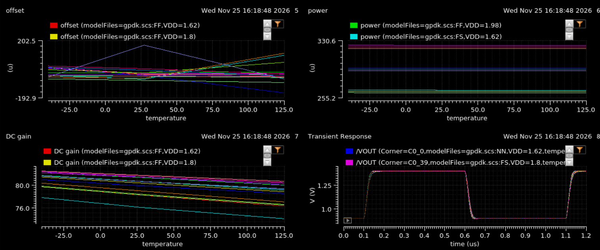
 
## 8. Monte Carlo (100% yield)
200 samples with random transistor mismatch.
 
Mismatch barely affects speed (PM σ = 0.8°) but sets the input offset:
 
$$\sigma(\Delta V_T) = \frac{A_{VT}}{\sqrt{WL}}$$
 
| | Mean | σ |
|---|---|---|
| Offset | 43 µV | 7.8 mV |
 
The small input pair of 2 µm² sets the offset. Doubling both W and L would roughly halve it.
 
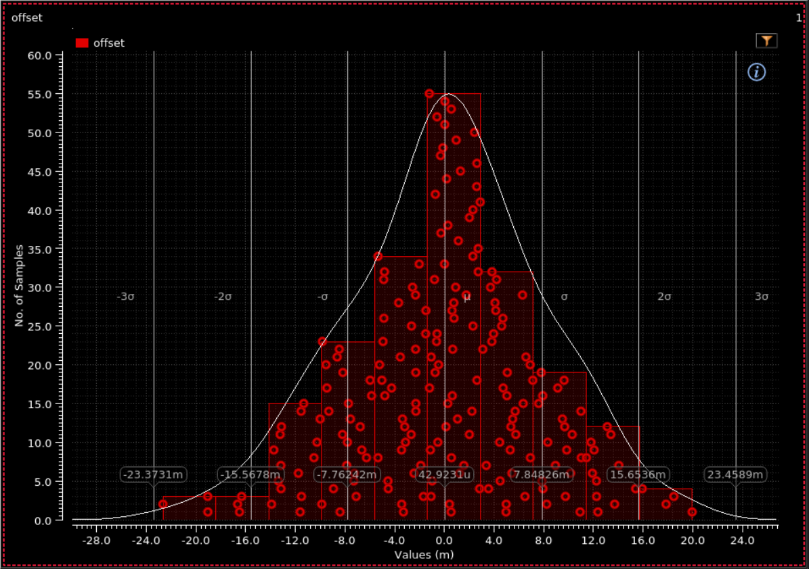
 
## Limitations/Further Considerations
- There is an ideal bias current source, making the PVT results optimistic
- Next Steps: layout, DRC/LVS, and post-layout simulation
